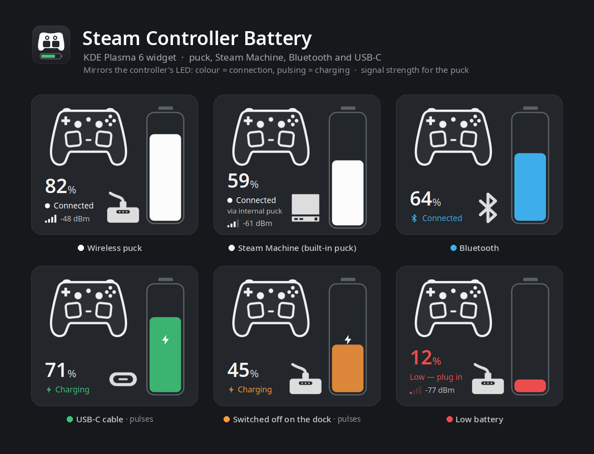

# Steam Controller 2 — Battery Widget for KDE Plasma

A background daemon + KDE Plasma 6 widget that shows the battery level and
connection status of the Steam Controller 2 ("Triton", released May 2026) on
Linux — reverse-engineered from its raw HID protocol, since the Linux kernel's
`hid-steam` driver doesn't support this controller yet (see below).




The widget mirrors the controller's own LED: **colour = how it's connected**
(white = puck, blue = Bluetooth, green = USB-C cable), **pulsing = charging**,
orange = switched off on the puck's dock, red = low battery.

## Why this exists

The Steam Controller 2 (VID:PID `28de:1304`) is not recognized by the kernel's
`hid-steam.c` driver — it falls back to generic `hid-generic`, which means:

- Nothing shows up under `/sys/class/power_supply/`
- `upower -e` shows no controller device
- There is no standard way to read the battery level

This project reads the raw HID report stream directly from `/dev/hidraw*`,
decodes the (fully undocumented, vendor-proprietary) battery field, and
exposes it to a small KDE Plasma widget.

Full reverse-engineering notes, including how the battery byte was found and
several dead ends that were ruled out, are in [PROTOCOL_NOTES.md](PROTOCOL_NOTES.md).

## What's included

| Path | What it is |
|---|---|
| [`plasmoid/com.jahrek.steamcontroller/`](plasmoid/com.jahrek.steamcontroller) | KDE Plasma 6 widget (QML): a card on the desktop, or an icon + popup in the panel |
| [`plasmoid/.../contents/code/sc_battery_daemon.py`](plasmoid/com.jahrek.steamcontroller/contents/code/sc_battery_daemon.py) | Python daemon bundled inside the widget: reads `/dev/hidraw*`, finds the controller by VID:PID, writes battery/connection state to `$XDG_RUNTIME_DIR/sc-battery.json`. The widget starts it automatically. |
| [`install.sh`](install.sh) | Installs the widget for the current user (alternative to the KDE Store) |
| `sc_dump.py`, `sc_monitor.py`, `sc_filter.py`, `sc_charge_monitor.py` | Diagnostic/research tools used to reverse-engineer the protocol (not needed just to use the widget) |
| [`PROTOCOL_NOTES.md`](PROTOCOL_NOTES.md) | Detailed HID protocol research notes |

## Status

This is a **working prototype** running on the author's own machine (Bazzite
Linux / KDE Plasma 6.7), not a polished, widely-tested release. Expect rough
edges. Tested only with one controller unit on one system.

## Requirements

- Linux with KDE Plasma 6
- Python 3 (no extra packages needed — uses only the standard library)
- udev/permissions that let your user read `/dev/hidraw*` for the controller.
  On most distros this "just works" thanks to a udev rule shipped for Steam;
  if not, you may need a udev rule granting your user rw access to the
  device's hidraw nodes.

## Install

**From the KDE Store:** right-click panel → *Add Widgets* → *Get New Widgets* →
search "Steam Controller Battery".

**From git:**

```bash
git clone https://github.com/jahrekza/steam-controller-plasma-widget.git
cd steam-controller-plasma-widget
./install.sh
```

Either way the widget is self-contained: it launches the bundled daemon itself
(single instance, guarded by a lock file), restarts it if it dies, and replaces
it after an update if the running one is from an older version. No
autostart entry or separate service needed. `setsid` (util-linux) and
`python3` must be on `PATH`.

Then add the widget: **right-click desktop/panel → Add Widgets → search "Steam Controller Battery"**.
To have it in the **system tray** instead: right-click the tray arrow → *Configure
System Tray…* → *Entries* → *Steam Controller Battery* → *Always shown*.

If it doesn't appear in the widget list, restart Plasma:
```bash
kquitapp6 plasmashell && kstart plasmashell
```

### Uninstall

```bash
kill "$(cat "$XDG_RUNTIME_DIR/sc-battery-daemon.lock")" 2>/dev/null
rm -rf ~/.local/share/plasma/plasmoids/com.jahrek.steamcontroller
```

If you installed v0.1, also remove its standalone daemon:
`rm ~/.local/bin/sc-battery-daemon ~/.config/autostart/sc-battery-daemon.desktop`

## How it works, in short

- Report ID `0x43` (sent every ~3.5 s) carries the battery percentage in
  byte[2]; the daemon reads it from every report, so the % follows the battery
  live. (Older versions read it only once per connection.)
- Every `0x43` also carries a charging flag (byte[1]: 1 = on battery,
  2 = charging) — in all modes, including a cable that only charges while the
  pad stays on Bluetooth.
- Over Bluetooth the pad exposes a standard Battery Service, so the battery %
  there is live and exact (read from BlueZ).
- Whether a silent pad is on the puck's dock or switched off is asked from the
  puck itself (command `0xB4` on its dock interface), every 3 s.
- The daemon writes `$XDG_RUNTIME_DIR/sc-battery.json` (atomic rename) the
  moment something changes; the widget reads it every second, so it follows
  the controller within a few seconds.

See [PROTOCOL_NOTES.md](PROTOCOL_NOTES.md) for the full derivation, including
two dead-end hypotheses that were ruled out with real data.

## Roadmap / next steps

- [ ] More calibration data points (currently only ~4%, ~44%, ~97% confirmed)
- [x] Detect charging state more reliably than "went silent" (0.3.5)
- [ ] Investigate whether a Feature Report can be used to actively query
      battery state over the puck (Bluetooth already reports it live)
- [ ] Consider upstreaming controller support to the kernel's `hid-steam.c`
      and/or contributing findings to the related
      [SDL issue](https://github.com/libsdl-org/SDL/issues/15471)

## Changelog

- **0.3.10** (2026-10-24) — new outline-style controller illustration; the battery
  no longer sits against the card's right edge (content is centred). On a Steam
  Machine the card says "via internal puck" and shows a small Steam Machine
  drawing next to the battery; the popup says "Internal puck (Steam Machine)".
- **0.3.9** (2026-10-24) — supports the receiver built into the Steam Machine
  (`28de:1305`), which wasn't recognised before. Receivers are now identified by
  USB ID, not just by name. Thanks to [u/Yurij89](https://www.reddit.com/user/Yurij89/)
  for reporting it and sending the details.
- **0.3.8** (2026-10-18) — the battery % is now live: read from every `0x43`
  report (~every 3.5 s) instead of once per connection, so it drops while you
  play (an hour-long session used to stay stuck at the starting value). After an
  update the widget replaces a daemon still running from the previous version,
  so fixes take effect without logging out.
- **0.3.7** (2026-10-18) — can live in the system tray (Configure System Tray →
  Entries → Steam Controller Battery). Panel/tray icon now matches the size of its
  neighbours and sits right next to the percentage.
- **0.3.6** (2026-10-18) — a pad on Bluetooth that sits on the puck's dock is now
  shown as "Charging · on puck" (blue, pulsing), not "Charging · cable".
- **0.3.5** (2026-10-18) — the widget now mirrors the controller's LED: colour =
  connection, pulsing = charging, orange pulsing = switched off on the dock.
  Charging is read from a flag the pad itself sends, so a USB-C cable/charger is
  detected in every mode. A pad that switched itself off is no longer shown as
  "charging on puck" — the puck is asked whether the pad is on its dock. Much
  faster updates: a few seconds instead of up to a minute. The daemon also
  notices a switch to cable/Bluetooth right after the pad goes quiet.
- **0.3** (2026-10-18) — redesign: desktop card (controller + tall battery,
  Connected / Charging / Low / Disconnected states), panel icon with bar and
  charging badge, expanded popup with details. Settings: low-battery threshold
  and optional notification. The daemon now reports the connection type and tells
  "pad docked on the puck" apart from "receiver unplugged". The controller on a
  USB-C cable (`28de:1302`) is now supported too and shown as "Charging · USB-C".
  Bluetooth (`28de:1303`) too, with a live battery % from the BLE Battery Service.
  Colours by connection: white = puck, blue = Bluetooth, orange = charging on the
  puck, green = USB-C cable, red = low battery.
- **0.2** (2026-09-20) — daemon is now bundled inside the plasmoid and started by
  the widget; v0.1 from the KDE Store was missing it entirely and never showed a
  reading. State file moved to `$XDG_RUNTIME_DIR`. Poll interval 30s → 10s.
- **0.1** (2026-08-12) — initial release.

## Contributing

Issues and PRs welcome — especially calibration data from other controller
units/battery levels, or testing on non-Bazzite KDE Plasma distros.

## License

MIT — see [LICENSE](LICENSE). Use it, fork it, break it, it's yours.
